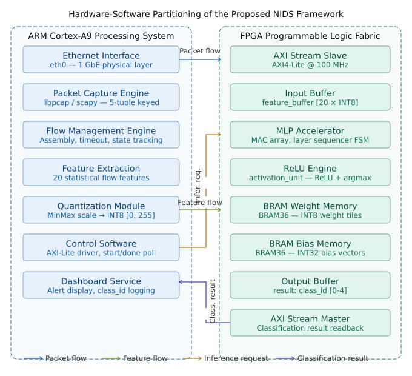
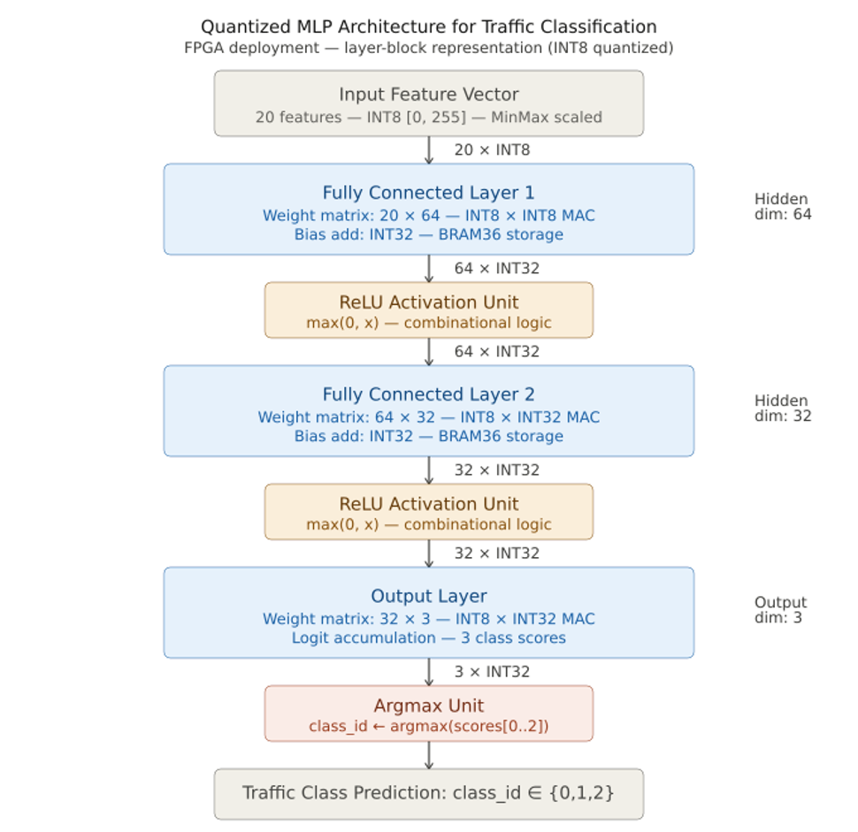
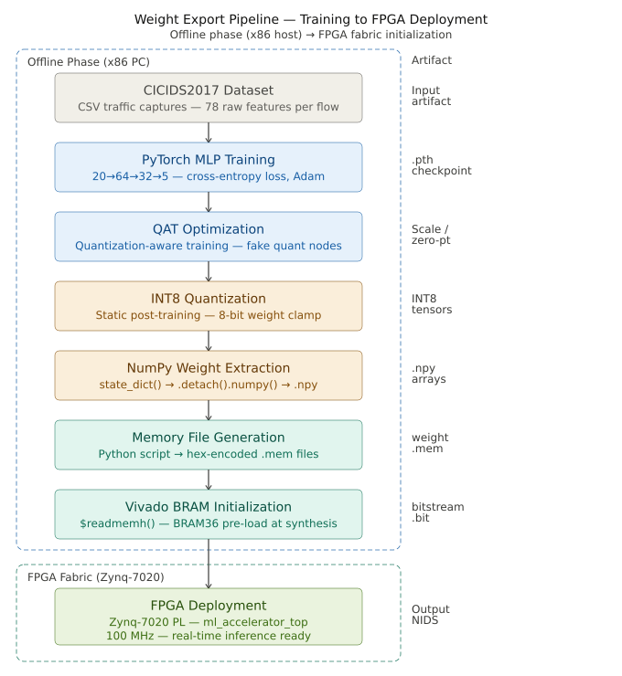

# FPGA-Accelerated Network Intrusion Detection System (NIDS)
### PYNQ-Z2 (Zynq-7020) · Real-Time Flow Classification · INT8 MLP Hardware Accelerator (RTL, in verification)

---

## Overview

This project implements a real-time **Network Intrusion Detection System** that captures live network traffic, reconstructs bidirectional flows, extracts CICIDS-style statistical features, and classifies each flow as **normal**, **DDoS**, or **botnet** traffic.

The system is built in two parallel tracks:

1. **Software pipeline (complete, tested, deployed):** a full flow-reconstruction and inference pipeline running on the PYNQ-Z2's ARM Cortex-A9 processing system (PS), performing MLP inference in pure NumPy, with a companion laptop-side traffic generator and live web dashboard. This track is fully functional end-to-end.
2. **Hardware MLP accelerator (designed in RTL, under verification):** a SystemVerilog INT8 MAC-array accelerator implementing the same 20→64→32→3 MLP topology, targeting the Zynq-7020 programmable logic (PL), exposed to the PS over AXI4-Lite (control/status) and AXI4-Stream (feature/logit transfer). The datapath is designed, and each module has a passing self-checking testbench, but it is **not yet integrated into the live PS inference loop** — today's live classification runs entirely on the ARM core in NumPy.

The goal of the hardware track is to eventually offload inference from the ARM core to the programmable logic, freeing the PS for packet capture and flow management while the PL performs deterministic, low-latency, low-power classification.

---

## Table of Contents

- [System Architecture](#system-architecture)
- [Hardware Accelerator (RTL)](#hardware-accelerator-rtl)
- [Machine Learning Model](#machine-learning-model)
- [Software Pipeline (PYNQ + Laptop)](#software-pipeline-pynq--laptop)
- [Feature Set](#feature-set)
- [Network Configuration](#network-configuration)
- [Repository Structure](#repository-structure)
- [Running the System](#running-the-system)
- [Verification Status](#verification-status)
- [Results](#results)
- [Integration Roadmap](#integration-roadmap)
- [Skills Demonstrated](#skills-demonstrated)
- [Authors](#authors)

---

## System Architecture

At the highest level, traffic generated on a laptop is sent over UDP to the PYNQ-Z2, where it is parsed into flows, converted into a 20-dimensional feature vector, classified by an MLP, and streamed back to a laptop-hosted dashboard.

```
┌──────────────────────────────┐                         ┌──────────────────────────────────────────────┐
│           LAPTOP             │                         │                PYNQ-Z2 (Zynq-7020)            │
│         192.168.2.1          │                         │              192.168.2.99                     │
├──────────────────────────────┤                         ├────────────────────────────────────────────────┤
│ advanced_traffic_generator.py│                         │  receiver.py  (main pipeline entry point)      │
│  9 concurrent traffic threads│──UDP:5555──────────────▶│    UDPReceiver → ParsedPacket                  │
│  Normal / DNS / Video        │                         │        │                                       │
│  DDoS flood / SYN flood      │                         │        ▼                                       │
│  Botnet C2 / exfil           │                         │  FlowEngine (bidirectional, FIN/RST + timeout) │
│  V/H Port-scan (OOD probe)   │                         │        │  FlowRecord                           │
│                               │                         │        ▼                                       │
│                               │                         │  FeatureExtractor (20 CICIDS-style features)  │
│                               │                         │        │  ExtractedFlow                        │
│                               │                         │        ▼                                       │
│                               │                         │  ┌───────────────────────────────────────┐    │
│                               │                         │  │   INFERENCE  (currently PS / NumPy)    │    │
│                               │                         │  │   NumpyMLP: FC→ReLU ×2 → Softmax       │    │
│                               │                         │  │   (BatchNorm folded, model_fp.npz)     │    │
│                               │                         │  │                                         │    │
│                               │                         │  │  ┄┄┄ future path (RTL, designed) ┄┄┄   │    │
│                               │                         │  │   AXI4-Lite ctrl/status                │    │
│                               │                         │  │   AXI4-Stream features →  mlp_top.sv   │    │
│                               │                         │  │   INT8 MAC-array accelerator (PL)      │    │
│                               │                         │  │   AXI4-Stream logits  ←  mlp_top.sv    │    │
│                               │                         │  └───────────────────────────────────────┘    │
│                               │                         │        │  JSON result (+ inference_ms)         │
│  dashboard_server.py          │◀──TCP:9000───────────────        ▼                                       │
│  Flask + SSE, served on :8080│                         │  ResultSender                                   │
└──────────────────────────────┘                         └────────────────────────────────────────────────┘
       │
       ▼
Browser → http://localhost:8080  (live classification dashboard)
```

The PS-side (ARM Cortex-A9) software pipeline — capture, flow reconstruction, feature extraction, NumPy inference, result streaming — is fully implemented and has been verified end-to-end on real Ethernet traffic between a laptop and the board. The PL-side (programmable logic) accelerator, shown in the dashed box above, is designed and simulated but sits outside the live data path until the AXI wiring in Vivado's block design and the PYNQ Python overlay driver are completed.

### Hardware–Software Partitioning

The diagram below shows the intended final partitioning once the accelerator is integrated: the ARM Cortex-A9 PS owns packet capture, flow management, feature extraction, and quantization, while the FPGA PL owns the MLP accelerator itself (MAC array, ReLU/argmax, and BRAM weight/bias storage), connected over AXI4-Stream / AXI4-Lite at 100 MHz.



*Figure: Hardware–software partitioning — PS-side flow pipeline (left) vs. PL-side MLP accelerator (right), connected via AXI4-Lite control and AXI4-Stream feature/result flows. This reflects the target partitioning; today the "MLP Accelerator" block executes on the PS in NumPy rather than on the PL.*

---

## Hardware Accelerator (RTL)

The accelerator (`mlp_top.sv`) implements the same 20→64→32→3 MLP topology as the software model, entirely in SystemVerilog, targeting the Zynq-7020 programmable logic. It is developed and simulated in Vivado, with each block individually testbenched before integration into the top-level module.

### Datapath Architecture

```
                         ┌────────────────────────────────────────────────────────┐
                         │                       mlp_top.sv                       │
                         │                                                        │
 s_axi_* (AXI4-Lite) ───▶│  axi_lite_slave ──▶ register_bank ──▶ control_fsm      │
                         │                         ▲                 │            │
                         │                  status/logits/latency    │ l1/l2/l3   │
                         │                         │              start/done      │
 s_axis_* (AXI4-Stream)─▶│  axi_stream_slave ──▶ feature_buffer[20]  │            │
                         │                                           ▼            │
                         │                                    layer1_mlp (20→64)  │
                         │                                     mac_array (×32)    │
                         │                                     ReLU + requant     │
                         │                                           │            │
                         │                                           ▼            │
                         │                                    layer2_mlp (64→32)  │
                         │                                     mac_array (×32)    │
                         │                                     ReLU + requant     │
                         │                                           │            │
                         │                                           ▼            │
                         │                                    layer3_mlp (32→3)   │
                         │                                     mac_array logits   │
                         │                                           │            │
                         │                                           ▼            │
 m_axis_* (AXI4-Stream) ◀│  axi_stream_master ◀── out_logits (register_bank)      │
                         └────────────────────────────────────────────────────────┘
```

### Module Breakdown

| Module | Role |
|---|---|
| `mlp_top.sv` | Top-level integration: resets, wires AXI, control FSM, and all three MLP layers together |
| `parameter_pkg.sv` | Single source of truth for layer dimensions, data widths, BRAM depths, and control bit positions |
| `axi_lite_slave.sv` | AXI4-Lite target — decodes control/status register reads and writes from the PS |
| `axi_stream_slave.sv` | AXI4-Stream sink — receives the 20-feature input vector, drives the feature buffer |
| `axi_stream_master.sv` | AXI4-Stream source — serializes the 3 output logits back to the PS |
| `register_bank.sv` | Memory-mapped control/status/logit registers (see [register map](#axi4-lite-register-map) below) |
| `feature_buffer.sv` | Captures the incoming 20 × int8 feature vector before layer 1 starts |
| `control_fsm.sv` | Sequences the three layers end-to-end: `IDLE → L1_START → L1_WAIT → L2_START → L2_WAIT → L3_START → L3_WAIT → OUTPUT_REQ → OUTPUT_WAIT → DONE`, with an `ERROR` state for stream/packet faults |
| `layer1_mlp.sv` / `layer2_mlp.sv` / `layer3_mlp.sv` | Per-layer wrapper: drives `mac_array`, adds bias from `bias_bram`, applies ReLU (layers 1–2) or leaves raw logits (layer 3) |
| `mac_array.sv` | Parallel MAC array — computes `PARALLELISM` (32) neurons simultaneously, each MAC accumulating sequentially across all inputs of that layer, with multi-pass sweeps for layers wider than 32 neurons |
| `mac_unit.sv` | Single signed int8×int8 multiply-accumulate cell with a 2-stage internal pipeline (registered multiply → registered accumulate) |
| `weight_bram.sv` / `bias_bram.sv` | Single-cycle-latency on-chip memories preloaded from `.mem` files exported from the trained quantized model |
| `activation_relu.sv` | INT8 ReLU with configurable requantization shift (`L1_SHIFT`, `L2_SHIFT`), matched to the QAT training scale |

### Design Parameters (`parameter_pkg.sv`)

| Parameter | Value | Description |
|---|---|---|
| Network topology | 20 → 64 → 32 → 3 | Matches the software MLP exactly |
| `FEAT_W` | 8 bits (signed) | Input feature precision |
| `W_WIDTH` | 8 bits (signed) | Weight precision |
| `BIAS_W` | 16 bits (signed) | Bias precision |
| `ACC_W` | 32 bits (signed) | Accumulator / logit precision |
| `PARALLELISM` | 32 MACs | Neurons computed simultaneously per pass |
| `AXIS_W` | 64 bits | AXI4-Stream data width |
| `ALIT_AW` / `ALIT_W` | 32 bits | AXI4-Lite address/data width |
| Weight BRAM depth | 1280 / 2048 / 96 words | `L1_IN×L1_OUT`, `L2_IN×L2_OUT`, `L3_IN×L3_OUT` |
| Bias BRAM depth | 64 / 32 / 3 words | One bias per output neuron, per layer |

### AXI4-Lite Register Map

| Address | Name | Access | Description |
|---|---|---|---|
| `0x00` | `CONTROL` | R/W | Bit 0 = `start` (self-clearing pulse, ignored while busy), Bit 1 = `reset` |
| `0x04` | `STATUS` | RO | Bit 0 = `idle`, Bit 1 = `busy`, Bit 2 = `done` |
| `0x08` | `NUM_FEATURES` | RO | Constant `20` |
| `0x0C` | `NUM_CLASSES` | RO | Constant `3` |
| `0x10` | `INF_COUNTER` | RO | Running count of completed inferences |
| `0x14` | `LATENCY_CYCLES` | RO | Clock cycles taken by the most recent inference |
| `0x20` | `LOGIT[0]` (normal) | RO | Sign-extended int32 logit |
| `0x24` | `LOGIT[1]` (ddos) | RO | Sign-extended int32 logit |
| `0x28` | `LOGIT[2]` (botnet) | RO | Sign-extended int32 logit |

### Control Flow (per inference)

1. PS streams 20 × int8 features into the accelerator over AXI4-Stream (`s_axis_*`); `feature_buffer` fills and asserts `full`.
2. PS writes `CONTROL.start = 1` over AXI4-Lite.
3. `control_fsm` walks `L1 → L2 → L3`, driving each layer's `mac_array` through its accumulation passes (32 neurons/pass, multiple passes for layers wider than 32).
4. On `L3_WAIT` completion, logits latch into `register_bank` and the FSM requests an output transfer.
5. `axi_stream_master` serializes the 3 logits back to the PS over AXI4-Stream (`m_axis_*`); `STATUS.done` and `INF_COUNTER` update.
6. Any AXI protocol violation or malformed stream frame sets `packet_error`/`status_error`, forcing the FSM to `S_ERROR` and clearing the feature buffer, so a single bad transaction can't corrupt the next inference.

### Why This Architecture

- **32-wide MAC array with multi-pass sweeps** keeps the accelerator small enough to fit comfortably in the Zynq-7020's programmable logic while still processing a 64-neuron layer in only 2 passes and a 32-neuron layer in 1.
- **INT8 weights/features with a 32-bit accumulator** mirror the quantization-aware-trained (QAT) software model bit-for-bit, so PL and PS results should match to within requantization rounding.
- **AXI4-Lite for control, AXI4-Stream for data** follows the standard Xilinx IP packaging convention, so the block can be dropped into a PYNQ overlay as a normal `pynq.MMIO` + DMA IP without custom driver work.
- **Explicit error state** (`S_ERROR`, `packet_error`, `status_error`) means a malformed AXI-Stream frame or protocol glitch can't silently corrupt in-flight weights or leave the FSM wedged — the whole datapath resets to a known-good idle state.

---

## Machine Learning Model

### Architecture

```
Input: 20 CICIDS-style flow features, min-max normalized to [0, 1]

FC(20 → 64) → ReLU     (BatchNorm folded into weights)
FC(64 → 32) → ReLU     (BatchNorm folded into weights)
FC(32 → 3)  → Softmax

Output: P(normal), P(ddos), P(botnet)
```



*Figure: INT8-quantized layer-block view of the same MLP as deployed for FPGA inference — 20×INT8 input → FC(20×64, INT8×INT8 MAC, INT32 bias) → ReLU → FC(64×32) → ReLU → FC(32×3, INT32 logits) → Argmax → `class_id`. This is the exact per-layer INT8/INT32 precision the RTL (`layer1_mlp.sv`/`layer2_mlp.sv`/`layer3_mlp.sv`, `mac_array.sv`, `activation_relu.sv`) implements, matching `parameter_pkg.sv`'s `FEAT_W=8`, `W_WIDTH=8`, `ACC_W=32`.*

### Dataset

Trained on a balanced subset of **CSE-CIC-IDS2018**, rebalanced from a heavily normal/DDoS-skewed raw distribution (300k / 300k / 146k) down to an equal 145,972 samples per class across `normal`, `ddos`, and `botnet`.

### Two Trained Variants

| Variant | Precision | Accuracy | Macro-F1 | Mean latency (CPU, 1-sample) | Role |
|---|---|---|---|---|---|
| **FP** (`model_fp.npz`) | Float32, BatchNorm folded | **99.5%** | 0.995 | ~24.4 µs | Runtime model on the PYNQ ARM core today |
| **QAT** (`model_qat.npz` / `.mem` files) | INT8 weights & activations | **98.8%** | 0.988 | ~62.0 µs (CPU emulation) | Target model for the RTL accelerator |

Both variants share the exact same 20→64→32→3 topology; QAT training matches the RTL's INT8 arithmetic and requantization shifts so that PL inference should reproduce the QAT model's confusion matrix once integrated.

### Class Definitions

| Class | Description |
|---|---|
| `normal` | Legitimate web, DNS, and video-streaming traffic |
| `ddos` | UDP flood and TCP SYN flood attacks |
| `botnet` | Command-and-control beaconing and data exfiltration |

> Port-scan traffic is intentionally generated as **out-of-distribution** input (the model has no `portscan` class) to demonstrate that each scanned port becomes its own single-packet flow and is classified into whichever of the three trained classes it lands nearest to — this is expected behavior, not a bug.

### Weight Export Pipeline (Training → FPGA Deployment)

Getting a trained model onto the FPGA fabric is a distinct offline pipeline, separate from the live inference path: it runs once (or whenever the model is retrained) on an x86 host, and its output is baked directly into the FPGA bitstream at synthesis time.



*Figure: Offline weight export flow — CICIDS2017 CSV captures → PyTorch MLP training (20→64→32→5, cross-entropy/Adam) → quantization-aware training (QAT, fake-quant nodes) → static post-training INT8 quantization → NumPy weight extraction (`state_dict()` → `.detach().numpy()` → `.npy`) → hex-encoded `.mem` file generation → Vivado BRAM initialization (`$readmemh`) → synthesized bitstream deployed to the Zynq-7020 PL.*

This mirrors the actual `.mem` files checked into `IDP07.srcs/sources_1/imports/NETWORK03/` (`layer1_weights_quantized3.mem`, `layer2_weights_quantized3.mem`, `layer3_weights_quantized3.mem`, and matching `*_bias_quantized3.mem` files), which `weight_bram.sv`/`bias_bram.sv` preload via `$readmemh` at synthesis — i.e. the trained INT8 weights are fixed into BRAM contents rather than loaded at runtime.

> Note: the diagram's training figures (78 raw CICIDS2017 features, a 20→64→32→**5**-class PyTorch head) describe the original/general export pipeline; the deployed model in this repo consumes the reduced **20**-feature vector documented above and classifies **3** classes (`normal`/`ddos`/`botnet`), matching `parameter_pkg.sv` (`L1_IN=20`, `L3_OUT=3`) and `constants.py` (`NUM_CLASSES=3`).

---

## Software Pipeline (PYNQ + Laptop)

The fully working, tested end-to-end pipeline runs entirely on the PYNQ-Z2's ARM Cortex-A9 (PS) today, without the PL accelerator in the loop.

### PYNQ-side (`receiver.py` and friends)

| File | Role |
|---|---|
| `receiver.py` | Main pipeline entry point: UDP receive → flow engine → feature extraction → NumPy inference → TCP result send |
| `capture.py` | `ParsedPacket` type and TCP flag constants |
| `flow_engine.py` | Bidirectional flow table with FIN/RST completion and idle timeout eviction |
| `extractor.py` | Converts a completed flow into the 20-feature CICIDS-style vector |
| `numpy_model.py` | Dependency-free NumPy forward pass (`FC → ReLU × 2 → Softmax`) for `model_fp.npz` |
| `constants.py` | Feature order, per-feature normalization ranges, class name mapping, and the AXI4-Lite register offsets the PL driver will eventually use |
| `model_fp.npz` | BatchNorm-folded float weights — the runtime model |
| `mlp_weights.npz` | Exported plain (non-folded) weights, used as an intermediate/reference artifact |

### Laptop-side

| File | Role |
|---|---|
| `advanced_traffic_generator.py` | 9 concurrent traffic-pattern threads: Normal web/DNS/video, DDoS UDP/SYN flood, Botnet C2/exfiltration, and vertical/horizontal port-scans (out-of-distribution) |
| `dashboard_server.py` | Flask + Server-Sent Events bridge: receives classification results over TCP:9000, serves the live dashboard over HTTP:8080 |
| `export_model.py` | One-time PyTorch `.pth` → `model_fp.npz` conversion, folding BatchNorm into the linear layers |
| `dataset_replay_generator.py` | Replays labeled CSV flow data as live traffic for repeatable testing |
| `tests/run_classification_demo.py` | Scripted Normal → DDoS → Botnet → mixed demo sequence |
| `tests/test_connectivity.py` | Minimal single-flow smoke test |

### Dashboard Features

Served on the laptop at `http://localhost:8080`, updating via SSE at ~1 Hz:

- Live classification donut (Normal / DDoS / Botnet split)
- Flows/sec rolling throughput chart
- Per-class bar chart with real average confidence overlay
- Average inference-time card (streamed per-flow from the PYNQ receiver)
- Top attacking source IPs
- Recent-flows feed (last 20 classified flows with confidence scores)
- PYNQ connection / system health status

---

## Feature Set

The same 20-feature CICIDS-style vector is used by both the software (NumPy) and hardware (RTL) inference paths:

| # | Feature | Description |
|---|---|---|
| 0 | `flow_duration` | Total flow duration (s) |
| 1 | `total_fwd_packets` | Forward packet count |
| 2 | `total_bwd_packets` | Backward packet count |
| 3 | `total_len_fwd_pkts` | Forward payload bytes |
| 4 | `total_len_bwd_pkts` | Backward payload bytes |
| 5 | `fwd_pkt_len_max` | Max forward packet length |
| 6 | `fwd_pkt_len_min` | Min forward packet length |
| 7 | `bwd_pkt_len_max` | Max backward packet length |
| 8 | `bwd_pkt_len_min` | Min backward packet length |
| 9 | `flow_bytes_per_sec` | Total bytes / duration |
| 10 | `flow_packets_per_sec` | Total packets / duration |
| 11 | `flow_iat_mean` | Mean inter-arrival time (s) |
| 12 | `flow_iat_std` | Std dev of inter-arrival times |
| 13 | `fwd_iat_mean` | Mean forward inter-arrival time |
| 14 | `bwd_iat_mean` | Mean backward inter-arrival time |
| 15 | `fwd_psh_flags` | Forward PSH flag count |
| 16 | `bwd_psh_flags` | Backward PSH flag count |
| 17 | `syn_flag_count` | SYN flag count |
| 18 | `rst_flag_count` | RST flag count |
| 19 | `avg_fwd_segment_size` | Average forward payload length |

Each feature is min-max normalized to `[0, 1]` using bounds recalibrated from robust 0.1/99.9 percentiles of CSE-CIC-IDS2018, then quantized to int8 for the RTL/QAT path.

---

## Network Configuration

| Device | Interface | Static IP | Role |
|---|---|---|---|
| Laptop | `eth0` / `enp*` | `192.168.2.1` | Traffic generator + dashboard backend |
| PYNQ-Z2 | `eth0` | `192.168.2.99` | Flow engine + inference |

```bash
# Laptop
sudo ip addr add 192.168.2.1/24 dev enp3s0
sudo ip link set enp3s0 up

# PYNQ-Z2 (via SSH, default password: xilinx)
ssh xilinx@<pynq-dhcp-ip>
sudo ip addr add 192.168.2.99/24 dev eth0
sudo ip link set eth0 up
```

Verify with `ping 192.168.2.99` (from laptop) and `ping 192.168.2.1` (from PYNQ).

---

## Repository Structure

```
NIDS/
├── LAPTOP/
│   ├── advanced_traffic_generator.py     # 9-pattern concurrent traffic generator
│   ├── dashboard_server.py               # TCP:9000 result sink + Flask/SSE dashboard on :8080
│   ├── dataset_replay_generator.py       # Replays labeled CSV flows as live traffic
│   ├── export_model.py                   # .pth → model_fp.npz conversion (BatchNorm folded)
│   └── tests/
│       ├── test_connectivity.py          # Minimal single-flow smoke test
│       └── run_classification_demo.py    # Normal → DDoS → Botnet → mixed demo
│
├── PYNQ/
│   ├── receiver.py                       # Main PS-side pipeline entry point
│   ├── capture.py                        # ParsedPacket type + TCP flag constants
│   ├── flow_engine.py                    # Bidirectional flow table (FIN/RST/timeout)
│   ├── extractor.py                      # 20-feature CICIDS extractor
│   ├── numpy_model.py                    # Pure-NumPy MLP inference engine (runtime model)
│   ├── constants.py                      # Feature order, normalization ranges, class map, AXI reg offsets
│   ├── model_fp.npz                      # BN-folded float weights (runtime model, ~99.5%)
│   └── mlp_weights.npz                   # Exported plain-precision reference weights
│
├── IDP_STATISTICS/                       # Model training, evaluation, and dataset generation
│   ├── generate_training_data.py         # Synthetic/replay dataset generation
│   ├── build_dataset.py                  # Raw → balanced dataset pipeline
│   ├── train_fp.py                       # Float model training
│   ├── train_qat.py                      # Quantization-aware training (INT8)
│   ├── validate_model.py / test_models.py / inference_metric.py
│   ├── model.py                          # PyTorch TrafficClassifier reference architecture
│   └── Images/
│       ├── Model_performance/            # Confusion matrices, training curves, FP vs QAT comparison
│       └── FPGA_results/                 # RTL testbench waveforms (AXI4-Lite, AXI4-Stream, per-layer)
│
└── IDP07/                                # Vivado project — RTL accelerator (hardware track)
    └── IDP07.srcs/
        ├── sources_1/new/
        │   ├── parameter_pkg.sv          # Global parameters (widths, dims, BRAM depths)
        │   ├── mlp_top.sv                # Top-level integration
        │   ├── axi_lite_slave.sv         # AXI4-Lite target
        │   ├── axi_stream_slave.sv       # AXI4-Stream feature ingest
        │   ├── axi_stream_master.sv      # AXI4-Stream logit output
        │   ├── register_bank.sv          # Control/status/logit registers
        │   ├── feature_buffer.sv         # Input feature staging
        │   ├── control_fsm.sv            # Layer sequencing FSM
        │   ├── layer1_mlp.sv / layer2_mlp.sv / layer3_mlp.sv
        │   ├── mac_array.sv              # Parallel (×32) MAC array
        │   ├── mac_unit.sv               # Single signed INT8 MAC cell
        │   ├── weight_bram.sv / bias_bram.sv
        │   └── activation_relu.sv        # INT8 ReLU + requantization
        ├── sources_1/imports/NETWORK03/  # layerN_weights/bias_quantized3.mem (QAT weight init files)
        └── sim_1/new/                    # Per-module self-checking testbenches (tb_*.sv)
```

---

## Running the System

The live demo runs the software pipeline described above (PL accelerator not yet in the loop).

### One-time setup

```bash
# 1. Export model weights (run on laptop)
python3 LAPTOP/export_model.py
#   reads:  IDP_STATISTICS/model_fp.pth
#   writes: PYNQ/model_fp.npz

# 2. Copy PYNQ files to the board
scp -r PYNQ/ xilinx@192.168.2.99:~/nids/
```

### Run sequence (3 terminals)

**Terminal 1 — PYNQ board**
```bash
ssh xilinx@192.168.2.99
cd ~/nids
python3 receiver.py --model model_fp.npz --laptop_ip 192.168.2.1
```

**Terminal 2 — Laptop: dashboard backend**
```bash
python3 LAPTOP/dashboard_server.py
```
Open `http://localhost:8080` in a browser.

**Terminal 3 — Laptop: generate traffic**
```bash
# Full concurrent 9-pattern stress test
python3 LAPTOP/advanced_traffic_generator.py --target_ip 192.168.2.99

# OR a clean sequential demo (Normal → DDoS → Botnet → mixed)
python3 LAPTOP/tests/run_classification_demo.py --target_ip 192.168.2.99
```

### Prerequisites

```bash
# Laptop
pip install flask
pip install torch numpy    # export_model.py only, one-time

# PYNQ-Z2
pip install numpy          # inference is pure NumPy — no torch needed on the board
```

### Running the RTL simulation (hardware track)

The RTL is developed and simulated in Vivado (project file: `IDP07/IDP07.xpr`). Each module has a dedicated testbench under `IDP07.srcs/sim_1/new/`:

```
tb_mac_unit.sv                 tb_layer1_mlp.sv          tb_axi_lite_slave.sv
tb_mac_array.sv                tb_layer2_mlp.sv          tb_axi_stream_slave.sv
tb_activation_relu_quant.sv    tb_layer3_mlp.sv          tb_control_fsm.sv
tb_register_bank.sv            tb_mlp_top.sv
```

Open the project in Vivado, set the desired testbench as the simulation top, and run behavioral simulation (`launch_simulation`). Waveform configuration for the MAC array is saved in `tb_mac_array_behav.wcfg`.

---

## Verification Status

| Component | Status |
|---|---|
| Software pipeline (capture → flow → feature → NumPy inference → dashboard) | ✅ Complete, tested end-to-end on real Ethernet traffic |
| `mac_unit` | ✅ Testbenched — signed INT8×INT8 MAC pipeline verified |
| `mac_array` | ✅ Testbenched — multi-pass parallel accumulation verified, drain-timing and clear-alignment bugs fixed |
| `layer1_mlp` / `layer2_mlp` / `layer3_mlp` | ✅ Individually testbenched against expected activations |
| `axi_lite_slave` | ✅ Testbenched — basic R/W, backpressure, invalid-strobe, simultaneous AW/W, and stress sequences all pass |
| `axi_stream_slave` / `axi_stream_master` | ✅ Testbenched |
| `control_fsm` | ✅ Testbenched — full `IDLE → L1 → L2 → L3 → OUTPUT → DONE` sequencing, plus `ERROR` path |
| `register_bank` | ✅ Testbenched — control/status/logit register R/W verified |
| `mlp_top` (full integration) | ✅ Simulated at module level via `tb_mlp_top.sv` |
| **PL ↔ PS integration on real hardware** | ⏳ **Not yet done** — no Vivado block-design/overlay wiring the accelerator to the Zynq PS, no PYNQ Python driver calling into the IP over `pynq.MMIO`/DMA. `receiver.py` on the board still performs inference in NumPy, not on the fabric. |

---

## Results

### Model Performance

- **FP model:** 99.5% accuracy / 0.995 macro-F1, ~24.4 µs mean single-sample CPU latency.
- **QAT (INT8) model:** 98.8% accuracy / 0.988 macro-F1 — the target for RTL inference, at a small accuracy cost from float→int8 quantization, matching the accelerator's arithmetic precision.
- Training used a class-balanced subset of CSE-CIC-IDS2018 (145,972 samples per class, downsampled from an initially normal/DDoS-heavy 300k/300k/146k raw split).

### RTL Simulation

- All per-module testbenches pass, including AXI4-Lite protocol compliance (basic R/W, backpressure, invalid strobe rejection, simultaneous address/data handshakes, and a directed stress sequence of interleaved reads/writes).
- Per-layer activation outputs from simulation match the expected quantized values from the QAT-trained `.mem` weight/bias initialization files.

*(Waveform captures and confusion matrices for both the FP/QAT models and the RTL testbenches are available under `IDP_STATISTICS/Images/`.)*

---

## Integration Roadmap

The RTL accelerator is functionally complete and verified at the module and top-level simulation stage, but three steps remain before it participates in a live classification:

1. **Vivado block design** — instantiate `mlp_top` alongside the Zynq-7020 PS7 block, wire `s_axi_*` to a PS AXI4-Lite master (GP port) and `s_axis_*`/`m_axis_*` to a DMA engine (e.g. AXI DMA or AXI-Stream FIFO) feeding from/to PS-side buffers.
2. **Bitstream generation and PYNQ overlay packaging** — synthesize, implement, and export the `.bit`/`.hwh` pair so the design can be loaded as a `pynq.Overlay` at runtime.
3. **PYNQ driver integration** — replace (or add a switch to) `PYNQ/numpy_model.py`'s forward pass with `pynq.MMIO` register writes (`CONTROL`, feature stream) and `STATUS`/logit register reads, using the offsets already reserved in `PYNQ/constants.py` (`AXILITE_CTRL`, `AXILITE_STATUS`, etc.), so `receiver.py` can transparently dispatch inference to the fabric instead of NumPy.

---

## Skills Demonstrated

**RTL / Digital Design**
- SystemVerilog datapath and FSM design
- INT8 quantized MAC-array architecture with pipelined multiply-accumulate
- AXI4-Lite and AXI4-Stream protocol implementation from scratch
- Self-checking testbenches, waveform-based verification, BRAM-based weight/bias memory design

**Machine Learning**
- MLP design, training, and quantization-aware training (QAT) for hardware deployment
- BatchNorm folding for inference-time efficiency
- Dataset balancing and evaluation (confusion matrices, macro-F1, latency benchmarking)

**Embedded Systems / Networking**
- Zynq-7020 PS/PL architecture (PYNQ-Z2)
- Real-time packet capture, bidirectional flow reconstruction, and CICIDS-style feature extraction
- UDP/TCP socket programming, Flask + Server-Sent Events live dashboards

---

## Authors

RV College of Engineering — Electronics and Communication Engineering
